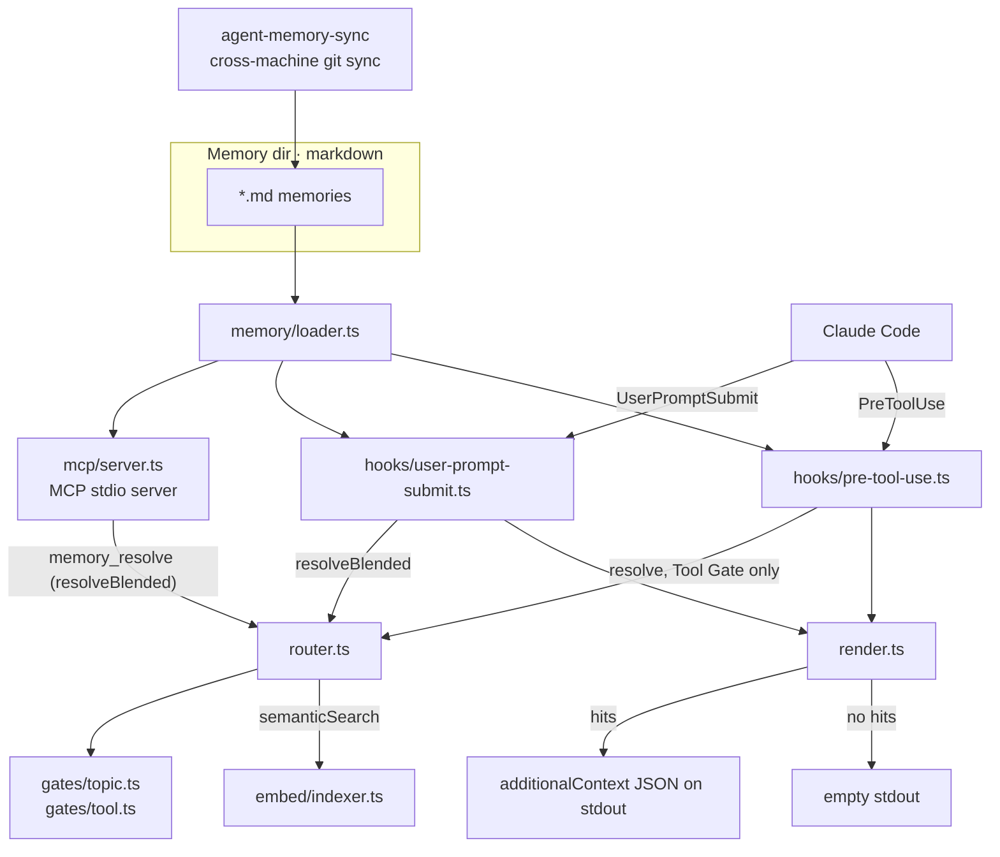
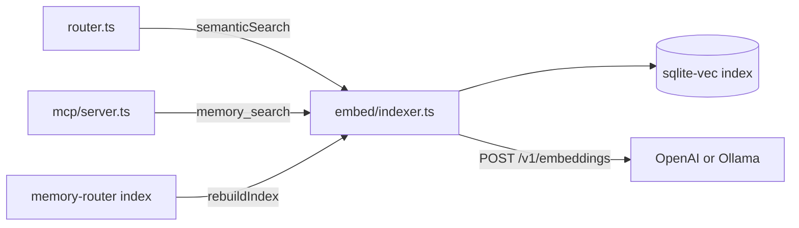

# agent-memory

**Persistence layer for AI agents.** Sync, route, and digest agent memories across sessions, machines, and platforms so an agent picks up where it left off instead of starting from scratch every time.

Most agent infrastructure assumes the model carries the context. It doesn't: the moment a session ends, the context window evaporates and the next run is a blank slate. agent-memory is the durable substrate underneath. Persist what you learned, sync it across machines, and let a routing layer decide which memories matter for the next prompt.

`memory-router` turns every prompt into a lookup over your markdown memory dir: matches are injected as `additionalContext`, misses leave the context window untouched. The Claude Code hooks and the MCP server load the memory files themselves and hand them to the router. `UserPromptSubmit` and the MCP tool `memory_resolve` use the score blend (`resolveBlended`); `PreToolUse` runs only the Tool Gate. The semantic part reads a sqlite-vec index that `memory-router index` builds offline. Building the index sends memory bodies to the embedding provider (OpenAI or Ollama); once the index exists, prompt text is sent there as well.

The first diagram shows the per-prompt and per-tool-call path from Claude Code or an MCP client to the injected context.



The second diagram shows who reads and builds the embedding index, and where the embedding provider is called.



## Packages

`agent-memory` is a folder of independent packages, not an npm workspaces / pnpm / lerna monorepo. There is no root `package.json`, no workspace manifest, and no shared root `node_modules`. Each package under `packages/` carries its own `package.json`, install, build, test, and version.

| Package | Reach for it when |
|---------|-------------------|
| [memory-router](packages/memory-router) | You want Claude Code to actually apply your memory files instead of hoping the model notices them. Topic / tool / confidence gates, lint, stale-reference detector. |
| [agent-memory-sync](packages/agent-memory-sync) | You run agents on more than one machine and need their memory dirs to converge via a shared git repo. Push / pull / cron / offline queue. |
| [memory-digest-cli](packages/memory-digest-cli) | You write daily memory logs and want a curated summary instead of re-reading raw markdown. Generates digests from `YYYY-MM-DD.md` files. |

The packages compose: `agent-memory-sync` keeps memory files in step across machines, `memory-digest-cli` distills the raw daily logs into curated summaries, and `memory-router` decides which entries get injected per prompt.

## Quick start

Prerequisites: Node.js 22 or newer (memory-router; the other packages need 20+), npm, and git. No API key is needed for this demo.

The flagship package is [`memory-router`](packages/memory-router): a deterministic memory-injection layer for Claude Code. Drive it once and the rest of the suite makes more sense.

```bash
git clone https://github.com/LanNguyenSi/agent-memory
cd agent-memory/packages/memory-router
npm install && npm run build

# Tiny scratch corpus so the demo doesn't touch your real memory dir.
mkdir -p /tmp/memory-router-demo
cat > /tmp/memory-router-demo/feedback_force_push.md <<'EOF'
---
name: No force-push to shared branches
description: Force-push on master/main overwrites history
type: feedback
topics: [destructive_ops]
severity: critical
---

NEVER force-push to master or main. The history is shared; rewriting
it costs every collaborator a hard reset and loses uncommitted work.
For local-branch fixes, prefer a fixup commit + interactive rebase
before push.
EOF

# Positive: prompt mentions force-push, the topic gate fires, the memory
# is injected.
echo '{"prompt":"can I git push --force to master to fix this?"}' \
  | MEMORY_ROUTER_DIR=/tmp/memory-router-demo \
    node dist/hooks/user-prompt-submit.js

# Negative: nothing matches, stdout stays empty (Claude's context stays clean).
echo '{"prompt":"rename foo to bar"}' \
  | MEMORY_ROUTER_DIR=/tmp/memory-router-demo \
    node dist/hooks/user-prompt-submit.js
```

If you only care about one package, work in its directory; nothing at the root needs to be set up first, and the pattern is the same for any of them: `cd packages/<name> && npm install && npm run build`.

## Usage

The positive prompt above prints one line of JSON on stdout:

```json
{"hookSpecificOutput":{"hookEventName":"UserPromptSubmit","additionalContext":"**memory-router** — 1 relevant memory applies:\n\n### No force-push to shared branches  _(topic · 1.00)_\nNEVER force-push to master or main. The history is shared; rewriting\nit costs every collaborator a hard reset and loses uncommitted work.\nFor local-branch fixes, prefer a fixup commit + interactive rebase\nbefore push."}}
```

Claude Code injects `additionalContext` as system context for the model on every prompt that matches. The negative prompt prints nothing and exits 0: when no gate fires, stdout stays empty so the context window stays clean. A stderr note about the missing embedding index is expected; the topic gate works without it.

## Documentation

- [memory-router README](packages/memory-router): full hook and MCP server wiring, lint, and stale-reference checker.
- [agent-memory-sync README](packages/agent-memory-sync): multi-machine sync setup, cron, and offline queue.
- [memory-digest-cli README](packages/memory-digest-cli): digest generation from daily logs.

## Development and contributing

Each package is self-contained: `cd packages/<name> && npm install && npm run build && npm test`. See [CONTRIBUTING.md](CONTRIBUTING.md) for branch naming, PR expectations, and the hook dogfooding step; [CODE_OF_CONDUCT.md](CODE_OF_CONDUCT.md) for conduct; [SECURITY.md](SECURITY.md) for reporting vulnerabilities.

## License

[MIT](LICENSE). Status: experimental. `memory-router` is the most production-shaped package (hook contract, MCP server, lint, stale detector, schema-versioned sqlite index); the other packages cover working but earlier-stage workflows, see each package README for current capabilities.
