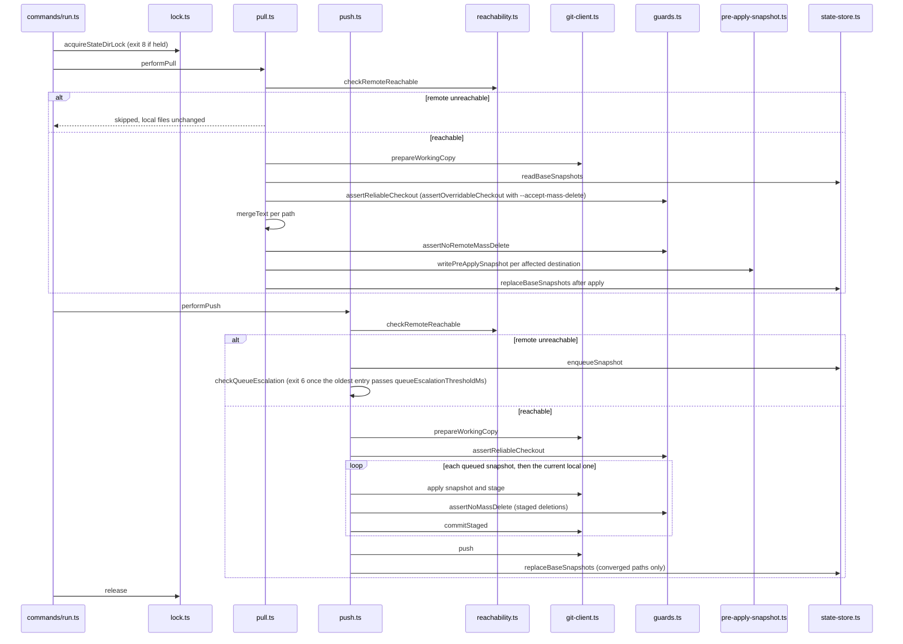

# Architecture: agent-memory-sync

## Overview

agent-memory-sync is a CLI tool implemented in **typescript** (CommonJS modules) using the **commander** framework.
Each top-level subcommand is registered by its own module under `src/commands/`; the sync logic it calls lives under
`src/memory-sync/`.

## Principles

1. **One module per top-level subcommand**: `run`, `watch`, `restore` and `config` each live in their own file under
   `src/commands/`; `config.ts` also registers its `show`, `get`, `set` and `reset` subcommands, and
   `watch-arming.ts` is a helper of `watch`, not a command.
2. **Fail fast with clear messages**: Validate inputs at parse time; emit actionable error messages to stderr.
3. **Exit codes are part of the interface**: Always exit with a meaningful code (see Exit Codes below).
4. **Stdout for data, stderr for diagnostics**: Program output goes to stdout; logs, warnings, and errors go to stderr.
5. **Composable with other tools**: Support `--output json` on commands that produce structured data.
6. **Config is optional**: The tool runs with no config file present; only `remoteUrl` must be provided (config file,
   `AGENT_MEMORY_SYNC_REMOTE_URL` or `--remote`).

## System Structure

```
agent-memory-sync/
├── src/
│   ├── commands/         # run, watch, restore, config, plus watch-arming (helper of watch)
│   ├── config/           # Config loading and validation
│   ├── memory-sync/      # Pull, push, merge, guards, snapshots, state, lock, reachability
│   ├── errors.ts
│   ├── output.ts
│   └── main.ts
├── tests/
│   ├── contract/          # Contract tests
│   ├── helpers/           # Shared test helpers
│   ├── integration/       # Integration tests
│   └── unit/              # Unit tests
├── profiles/              # Per-machine configs (mac mini, MacBook, Linux); only *.example.json templates are committed, real profiles are local-only
├── docs/
│   ├── architecture.md
│   ├── ways-of-working.md
│   ├── cli-reference.md
│   ├── sync-behavior.md
│   ├── service-supervision.md
│   ├── machine-setup.md   # Multi-machine bootstrap, activation, restore/rollback
│   ├── launchd/            # macOS LaunchAgent templates for `watch` and `sync`
│   └── adrs/
└── README.md
```

### Module map

- `src/main.ts`: creates the root program, registers the four subcommands, and maps a thrown error to its exit code.
- `src/commands/run.ts`: `run [profile]` in `sync`, `push` or `pull` mode, optionally on a cron schedule.
- `src/commands/watch.ts`: `watch [profile]`, a debounced push per local change.
- `src/commands/watch-arming.ts`: the `watch` startup wait for syncPaths that do not exist yet and for a live
  operating system file watch.
- `src/commands/restore.ts`: `restore` of a file from a commit, or of a whole destination from a commit or a pre-apply
  snapshot.
- `src/commands/config.ts`: `config show`, `get`, `set` and `reset`.
- `src/config/loader.ts`: defaults, config file, environment variables and CLI overrides merged into one run config.
- `src/errors.ts`: `CliError` and its subclasses, each carrying the exit code of the README's exit-code table.
- `src/output.ts`: `writeResult` (stdout, text, JSON or YAML) and the stderr diagnostics `writeInfo`, `writeWarning`
  and `writeDryRun`.
- `src/memory-sync/pull.ts`: `performPull`, the pull half of a sync.
- `src/memory-sync/push.ts`: `performPush`, the push half, including the offline queue and its replay.
- `src/memory-sync/merge.ts`: three-way text merge and conflict-marker detection.
- `src/memory-sync/guards.ts`: the mass-delete guards and the checks that a fetched working copy can be trusted.
- `src/memory-sync/accept-remote-deletions.ts`: adopting remote deletions under `--accept-mass-delete`.
- `src/memory-sync/pre-apply-snapshot.ts`: writing, reading back and rotating pre-apply snapshots.
- `src/memory-sync/snapshot.ts`: the `watch` commit message.
- `src/memory-sync/state-store.ts`: base snapshots, the offline queue and temp clones under `stateDir`.
- `src/memory-sync/lock.ts`: the per-`stateDir` lock.
- `src/memory-sync/reachability.ts`: the remote reachability precheck.
- `src/memory-sync/scheduler.ts`: cron expression validation and the next tick.
- `src/memory-sync/preview.ts`: the one-line text summary of a run.
- `src/memory-sync/restore-alias.ts`: file identity checks that stop a restore from removing the file it just wrote.
- `src/memory-sync/git-client.ts`: git operations on temp clones (fetch, checkout, commit, push).
- `src/memory-sync/config.ts`: sync path types and the mapping between local paths and hub paths.

## Key Subsystems

### 1. Command Parsing (commander)

Commands are registered on a `Command` instance. Each subcommand has its own Command object; an excerpt of the real
`run` registration (`src/commands/run.ts`):

```typescript
function registerRunCommand(program: import("commander").Command): void {
  program
    .command("run")
    .description("Sync local memory files with the configured Git repository")
    .argument("[profile]", "Configuration profile to execute", "default")
    .option("--config <path>", "Override config file path")
    .option("--mode <mode>", "Sync mode: sync, push, pull", "sync");
  // ... further options, then .action(...)
}
```

The root program is created in `src/main.ts`, which registers `run`, `config`, `watch` and `restore` before
`program.parseAsync()`.

### 2. Config Loading

Config is loaded in layers, with later layers overriding earlier ones:

```
1. Compiled-in defaults
2. Environment variables (AGENT_MEMORY_SYNC_*)
3. Config file
4. CLI flags passed at runtime
```

An environment variable therefore takes effect only for a key the config file does not set. `run`, `watch` and
`restore` always pass `--output`, `--verbose`, `--quiet` and the color flag as CLI values (their CLI defaults when not
given), so the matching config keys and environment variables have no effect on these commands. The README's
[Configuration](../README.md#configuration) section lists every key with its default and environment variable.

The config loader lives in `src/config/loader.ts`. It is responsible for:

- Locating the config file (respects `--config`, `AGENT_MEMORY_SYNC_CONFIG` and `XDG_CONFIG_HOME`)
- Parsing the JSON file and normalizing its keys
- Merging environment variable overrides
- Returning a validated run config to `run`, `watch` and `restore`
- Reading, writing and removing the config file for `config get`, `set` and `reset`

`run`, `watch`, `restore` and `config show` call `loadConfig` from `src/config/loader.ts` in their action handlers;
`run`, `watch` and `restore` then pass the loaded config and their CLI values to `resolveRunConfig`. `config get`,
`set` and `reset` do not call `loadConfig`: they read or write the file through `readPersistedConfig`,
`writePersistedConfig` and `resetPersistedConfig`, and `readPersistedConfig` returns empty settings for a missing file.
The loader does not depend on any command module, so `tests/unit/env-config.test.ts` calls `loadConfig` and
`resolveRunConfig` directly.

Config file path resolution order:

1. Value of `--config` flag
2. `$AGENT_MEMORY_SYNC_CONFIG` environment variable
3. `$XDG_CONFIG_HOME/agent-memory-sync/config.json`
4. `~/.config/agent-memory-sync/config.json`

### 3. Output Formatting

Commands write their result through a shared output layer (`src/output.ts`):

- **`output text`**: a human-readable summary line per run
- **`output json`**: machine-readable JSON
- **`output yaml`**: machine-readable YAML

Color applies only to the diagnostics on stderr. They are colored unless `--no-color` is passed; `NO_COLOR` and piping
do not turn color off, because `run`, `watch` and `restore` always pass the color flag's CLI default.

### 4. Error Handling and Exit Codes {#exit-codes}

All errors are caught at the top-level command runner and translated to appropriate exit codes. Commands signal failure
by raising/returning an error; they never call `process.exit()` directly.

Every distinguished exit code, its meaning and what to do about it is documented in one place,
[the README's Exit codes table](../README.md#exit-codes) - that table is canonical; this file does not keep a second
copy that could drift out of sync with the `CliError` subclasses in `src/errors.ts`.

Error messages follow the pattern: `error: <what went wrong>. <how to fix it>.`

Good: `error: remote URL is not configured. Set 'remoteUrl' in the config file or pass --remote.`
Bad: `FileNotFoundError: [Errno 2] No such file or directory`

### 5. Logging and Verbosity

Diagnostic output is gated by a verbosity level:

- **Default**: warnings and errors only
- **`--verbose` / `-v`**: informational messages
- **`--quiet` / `-q`**: suppress non-error diagnostics

Structured log lines go to stderr and never to stdout.

### 6. Sync flow

The diagram shows the order of one `run --mode sync` tick: lock, pull, guards, snapshots, merge, push, queueing and the
base-snapshot advance. [Sync behavior](sync-behavior.md) explains each step.



In words: `run` takes the state-directory lock, then `performPull` checks reachability, fetches the hub into a temp
clone, reads the base snapshots, checks that the checkout can be trusted, merges each path, applies the remote
mass-delete guard, writes the pre-apply snapshots, applies the plan and advances the base. `performPush` then checks
reachability again; an unreachable remote queues the local snapshot, otherwise it checks the fetched checkout, applies
each queued snapshot and then the current local one, checks each one's staged deletions against the mass-delete guard
before committing it, pushes once, and advances the base for the paths that converged.

A guard that refuses ends the run with its exit code. A pull-side refusal comes before the pull half writes any local
file; a push-side refusal comes before anything is pushed, and the queued snapshots stay queued. The pull half runs to
completion first, so in a sync tick a push-side refusal (exit 5 or 7) comes after the pull half has already applied the
remote changes to the local files. A `watch` tick takes the same lock and runs only the push half
(`src/commands/watch.ts`); a push that fails with a remote error is queued the same way as an unreachable remote
(`src/memory-sync/push.ts`).

## CI/CD Architecture

The pipeline runs on GitHub Actions: the repository root's [.github/workflows/ci.yml](../../../.github/workflows/ci.yml),
one matrix job per package, on Node 22.

Current verification steps, in order:

1. **install** - `npm ci --no-audit --no-fund`
2. **native-dep smoke** - a no-op for this package (it only exercises `memory-router`'s native bindings)
3. **typecheck** - `npm run typecheck`
4. **build** - `npm run build`
5. **lint** - `npm run lint`, an alias for `typecheck` in this package
6. **format** - `npm run format:check` (Prettier; runs for this package only)
7. **test** - `npm run test:coverage`, with coverage thresholds of 86% lines, 65% branches and 86% functions

## Testing Strategy

Approach: **integration-tests**

Tests run `src/main.ts` through tsx as a subprocess (no build needed first) and assert on:

- Exit code
- stdout content (exact match or substring)
- stderr content (for error cases)

This validates argument parsing, config loading, and output formatting end-to-end. Unit tests under `tests/unit/` call
modules directly.

## Decisions

See [ADR log](adrs/) for architectural decisions and their rationale.
