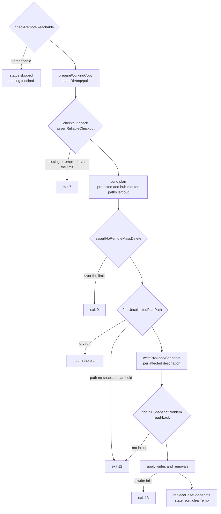

# Destructive-write safety chain and its exit codes

## The invariant

- In a pull and a push, including the `--accept-mass-delete` adoption, no
  local file is removed or overwritten before a verified pre-apply snapshot
  holds its current content.
- Without an override flag, a pull applies no deletions over the
  mass-delete thresholds and a push publishes none over them in any one
  snapshot, and neither applies or publishes a deletion while the working
  copy it comes from is missing or has zeroed more base-tracked files than
  those thresholds allow. A push that replays queued snapshots measures
  each snapshot on its own, so one run can publish more than `maxFiles`
  deletions in total. `--allow-mass-delete` lets a push publish
  deletions over the thresholds. `--accept-mass-delete` lets a pull apply
  them, and lets missing (lost) paths through the checkout check: a pull
  applies the deletions its merge plans for them, and a push adopts them by
  removing the local copies, in both cases with no threshold (see
  [The two override flags](#the-two-override-flags)). No flag lets a
  checkout finding with zeroed (emptied) paths through.
- Every refusal before the first local write leaves the local files, the
  hub and the base snapshot as they were, so the same command can be
  repeated. A push refused after an `--accept-mass-delete` adoption keeps
  the adoption: its local removals and its base update stay.
- `restore` is outside this guarantee. The `restore <sha>` form overwrites
  the named local files with no pre-apply snapshot, and a destination
  restore writes after a snapshot it does not read back and removes files
  without the mass-delete thresholds (see
  [Restore writes](#restore-writes) below).

The checks run in a fixed order, and the order is part of the guarantee:
each refusal must happen before the first write it protects. All of them
run under the state-directory lock that `run`, `watch` and `restore` take
first (see [offline-queue-and-lock.md](offline-queue-and-lock.md)).

## Pull: the order of checks

The diagram shows `performPull` from the reachability precheck to the base
write, with the exit code each refusal raises.

1. **Reachability precheck.** An unreachable hub returns status `skipped`
   with nothing touched
   (`packages/agent-memory-sync/src/memory-sync/pull.ts:76-92#"skipped pull, local files unchanged"`).
2. **Working copy.** The hub branch is fetched into `stateDir/tmp/pull`
   (`packages/agent-memory-sync/src/memory-sync/pull.ts:94-99#"PULL_TEMP_LABEL)"`).
   A failing `git ls-remote` raises `RemoteUnavailableError` (exit 4); in
   `run --mode sync` that one error turns the tick into a push-only run
   instead of failing it
   (`packages/agent-memory-sync/src/commands/run.ts:331-334#"notes: [...(pushResult.notes || []), diagnostic]"`).
3. **Checkout check, exit 7.** Before any merge, the fetched tree is
   compared with the base snapshot per destination
   (`packages/agent-memory-sync/src/memory-sync/pull.ts:140-141#"assertReliableCheckout({"`).
   A tracked path that is absent from the working copy counts as lost, a
   tracked non-empty path that is present with zero bytes counts as
   emptied, and lost plus emptied is held to the mass-delete thresholds
   below
   (`packages/agent-memory-sync/src/memory-sync/guards.ts:447-453#"unreliable > tracked * guard.maxRatio"`).
   The check is skipped when the hub branch does not exist yet
   (`packages/agent-memory-sync/src/memory-sync/guards.ts:429-431#"return null;"`).
   With `--accept-mass-delete` the pull calls `assertOverridableCheckout`
   instead
   (`packages/agent-memory-sync/src/memory-sync/pull.ts:133-134#"assertOverridableCheckout({"`),
   which refuses only a finding with emptied paths; lost paths then reach
   the plan as deletions.
4. **Plan.** The merge builds the full list of writes and removals before
   any of them runs. A local-only file with no base entry is never a
   deletion, and a path whose hub copy carries conflict markers is left out
   (see [base-snapshot-lifecycle.md](base-snapshot-lifecycle.md)).
5. **Plan guard, exit 9.** `assertNoRemoteMassDelete` counts the plan's
   deletions against the base snapshot, for a dry run too
   (`packages/agent-memory-sync/src/memory-sync/pull.ts:378-383#"acceptMassDelete: options.acceptMassDelete"`).
6. **Collectability, exit 12.** A planned path that exists on disk but was
   not collected as a regular sync file (a symlink, a directory, a case or
   Unicode variant of the hub name, a file created after collection) stops
   the run before any snapshot is written
   (`packages/agent-memory-sync/src/memory-sync/pull.ts:391-401#"aside and run the pull again"`,
   `packages/agent-memory-sync/src/memory-sync/pre-apply-snapshot.ts:309-311#"return entry.remoteRelativePath;"`).
   Stopping here keeps a persistent cause from rotating older snapshot
   generations away on every retry. A dry run returns after this check.
7. **Pre-apply snapshots.** Every destination in which the plan removes or
   overwrites a file is copied to `stateDir/snapshots/<destination>/<id>`
   (`packages/agent-memory-sync/src/memory-sync/pull.ts:420#"snapshotAffectedDestinations(config, plan"`);
   a destination the plan only adds to is not
   (`packages/agent-memory-sync/src/memory-sync/pull.ts:589-590#"!entry.overwrite"`).
   Writing a generation removes the oldest ones beyond `snapshotGenerations`
   (default 3) for that destination
   (`packages/agent-memory-sync/src/memory-sync/pre-apply-snapshot.ts:217-222#"rmSync(entry.dir"`,
   `packages/agent-memory-sync/src/memory-sync/pre-apply-snapshot.ts:38#"DEFAULT_SNAPSHOT_GENERATIONS = 3"`).
8. **Read-back, exit 12.** Each snapshot is read back before the first
   write. Which paths it must hold is decided from the disk at that moment,
   not from the earlier collection, so a file that appeared since the
   collection must be in it as well
   (`packages/agent-memory-sync/src/memory-sync/pull.ts:644-648#"if (!pathExistsOnDisk(entry.localAbsolutePath)) {"`,
   `packages/agent-memory-sync/src/memory-sync/pull.ts:429-435#"if (snapshotProblem) {"`).
9. **Apply, exit 13.** A write or removal that throws part way stops the
   loop. The error names what was already applied and the snapshot
   generations that hold the previous content; the base snapshot has not
   moved
   (`packages/agent-memory-sync/src/memory-sync/pull.ts:461-482#"throw new PartialApplyError("`).
10. **Base write.** Only now are the base snapshot and `state.json`
    written and the working copy removed
    (`packages/agent-memory-sync/src/memory-sync/pull.ts:512-516#"stateStore.clearTemp(PULL_TEMP_LABEL);"`).

## Push: the order of checks

1. **Reachability precheck.** An unreachable hub queues the current
   snapshot instead of pushing (see
   [offline-queue-and-lock.md](offline-queue-and-lock.md)).
2. **Checkout check, exit 7, or adoption.** Without `--accept-mass-delete`
   the fetched working copy goes through the same `assertReliableCheckout`
   as on the pull side
   (`packages/agent-memory-sync/src/memory-sync/push.ts:298-299#"assertReliableCheckout({"`).
   With it, `acceptRemoteDeletions` runs instead
   (`packages/agent-memory-sync/src/memory-sync/push.ts:273-274#"acceptRemoteDeletions({"`)
   and adopts the hub's deletions locally behind its own chain:
   collectability (exit 12)
   (`packages/agent-memory-sync/src/memory-sync/accept-remote-deletions.ts:154-156#"throw new AdoptionSnapshotNotIntactError("`),
   a pre-apply snapshot per affected destination
   (`packages/agent-memory-sync/src/memory-sync/accept-remote-deletions.ts:172-186#"snapshots.push(written.id);"`),
   the read-back (exit 12)
   (`packages/agent-memory-sync/src/memory-sync/accept-remote-deletions.ts:202-208#"throw new AdoptionSnapshotNotIntactError("`),
   the local removals (exit 13 on a failure part way)
   (`packages/agent-memory-sync/src/memory-sync/accept-remote-deletions.ts:220-224#"throw new PartialApplyError("`),
   and the base update.
3. **Plan guard, exit 5, per snapshot.** Each snapshot (queued ones first,
   then the current one) is merged into the working copy and staged; the
   guard then counts the deletions git actually staged, not the merge's own
   plan, limited to paths the hub tracked when the run started
   (`packages/agent-memory-sync/src/memory-sync/push.ts:343-349#"allowMassDelete: options.allowMassDelete"`,
   `packages/agent-memory-sync/src/memory-sync/push.ts:1073-1074#"runStartTracked.has(remoteRelativePath)"`).
   Staged deletions outside `repositorySubdir` count toward the total rule.
   The denominator for the current snapshot is the base as the run found
   it, before any adoption
   (`packages/agent-memory-sync/src/memory-sync/push.ts:182#"guardBaseFiles: currentBaseMap,"`).
4. **Commit and push.** The commit takes the measured index as it is, with
   no second staging step
   (`packages/agent-memory-sync/src/memory-sync/push.ts:361#"gitClient.commitStaged(workingCopy.repoDir, snapshot.message);"`),
   and one `git push` follows after the last snapshot
   (`packages/agent-memory-sync/src/memory-sync/push.ts:367#"gitClient.push(workingCopy.repoDir, config.branch);"`).
   A refusal at any snapshot therefore leaves the hub untouched and the
   queue as it was.

`run --mode push --dry-run` previews the same checks in a throwaway working copy
labelled `push-preview`, including the per-snapshot plan guard
(`packages/agent-memory-sync/src/memory-sync/push.ts:741-746#"allowMassDelete: options.allowMassDelete"`).

## Mass-delete thresholds

The defaults are `maxRatio: 0.1` and `maxFiles: 20`
(`packages/agent-memory-sync/src/memory-sync/guards.ts:54-56#"maxFiles: 20"`),
overridable per profile through `massDeleteGuard` but not switched off by
configuration (see [config-resolution.md](config-resolution.md)).
`findMassDelete` refuses, per sync destination, more than `maxFiles`
deletions, or at least two deletions that also exceed `maxRatio` of the
paths the base tracks there
(`packages/agent-memory-sync/src/memory-sync/guards.ts:74#"MIN_PROPORTIONAL_DELETIONS = 2"`,
`packages/agent-memory-sync/src/memory-sync/guards.ts:207-211#"deleted > tracked * guard.maxRatio"`),
and more than `maxFiles` deletions across all destinations together
(`packages/agent-memory-sync/src/memory-sync/guards.ts:220-229#"destination: null"`).
The checkout check applies the per-destination rules to lost plus emptied
paths and has no cross-destination total.

## The two override flags

| Flag                   | Commands       | Overrides                                                                                                                            | Does not override                                                                                                                                                                                                 |
| ---------------------- | -------------- | ------------------------------------------------------------------------------------------------------------------------------------ | ----------------------------------------------------------------------------------------------------------------------------------------------------------------------------------------------------------------- |
| `--allow-mass-delete`  | `run`, `watch` | the push plan guard (exit 5)                                                                                                         | the checkout check (exit 7), anything on the pull side                                                                                                                                                            |
| `--accept-mass-delete` | `run` only     | the pull plan guard (exit 9); a checkout finding with lost paths only, by adopting the deletions locally behind a pre-apply snapshot | a checkout finding with any emptied path, which is refused whatever the flag (`packages/agent-memory-sync/src/memory-sync/guards.ts:662-664#"throw new UnreliableCheckoutError(buildUnreliableCheckoutMessage("`) |

Passing both to one `run` is a usage error, exit 2, checked before the
config is read
(`packages/agent-memory-sync/src/commands/run.ts:92-93#"throw new CliError("`).
`watch` has no `--accept-mass-delete`, since a flag on a long-running
command would consent for every future tick
(`packages/agent-memory-sync/src/commands/watch.ts:39-40#"consent for every"`).
A `watch` tick refused with exit 5 or 7 logs a warning and keeps watching;
any other error from the tick's push stops the watcher with that error's
exit code
(`packages/agent-memory-sync/src/commands/watch.ts:581#"error instanceof UnreliableCheckoutError"`).
A tick that finds the state directory locked is deferred instead (see
[offline-queue-and-lock.md](offline-queue-and-lock.md)).

## Restore writes

`restore <sha> [--path 
]` writes each named file from the hub commit
straight over the local copy. It takes no pre-apply snapshot, so content
that existed only in the overwritten local file is not kept anywhere
under `stateDir`
(`packages/agent-memory-sync/src/commands/restore.ts:268#"writeFileSync(absoluteLocalPath, content"`).
Without `--path` it needs `--yes` or `--dry-run`
(`packages/agent-memory-sync/src/commands/restore.ts:135-137#"full-snapshot restore requires --yes"`).

`restore <profile> <destination> --from-commit|--from-snapshot` replaces a
whole destination, removals included. It refuses with exit 12, before any
snapshot or write, when a target path cannot be written or removed
(`packages/agent-memory-sync/src/commands/restore.ts:491-492#"throw new RestoreDestinationNotWritableError("`)
or when a path it writes and a path it removes are the same file on the
filesystem
(`packages/agent-memory-sync/src/commands/restore.ts:511-512#"throw new RestoreDestinationNotWritableError("`).
It then snapshots the destination's current files and writes; unlike pull,
it does not read that snapshot back before writing
(`packages/agent-memory-sync/src/commands/restore.ts:533-540#"generations: runConfig.snapshotGenerations"`).
Its removals are not counted against the mass-delete thresholds: every
file in the destination that the source does not hold is removed
(`packages/agent-memory-sync/src/commands/restore.ts:450-451#"!sourcePaths.has(file.remoteRelativePath)"`,
`packages/agent-memory-sync/src/commands/restore.ts:558-559#"rmSync(file.absolutePath, { force: true });"`).

## What breaks it

- Writing the pre-apply snapshot before the collectability check: a
  persistent cause would add one generation per retry and rotate away the
  generation that holds the last good copy.
- Measuring the push guard on the merge plan instead of the staged index:
  a path the working copy was already missing is not in the plan, yet
  staging all changes publishes its deletion.
- Letting `--accept-mass-delete` accept an emptied finding: a working copy
  truncated in place would be adopted as the hub's real content.
